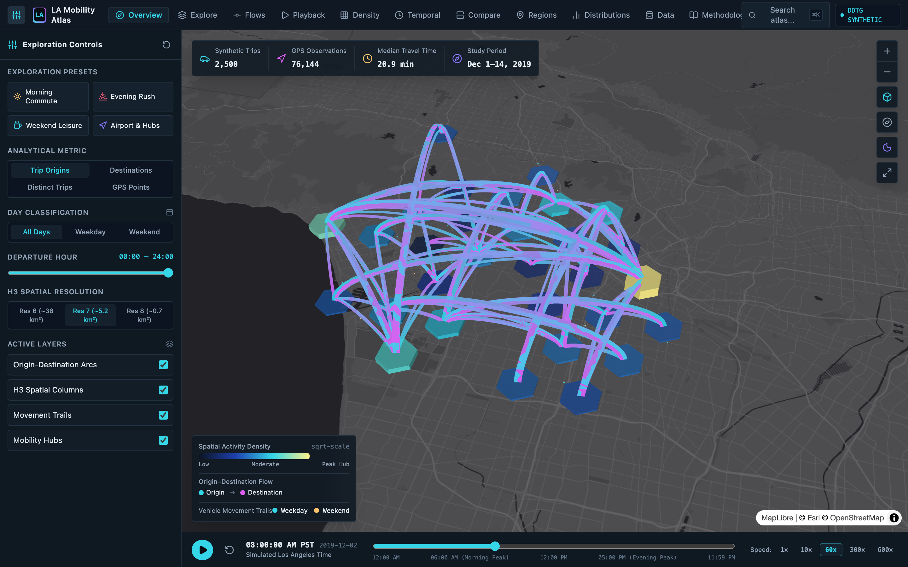
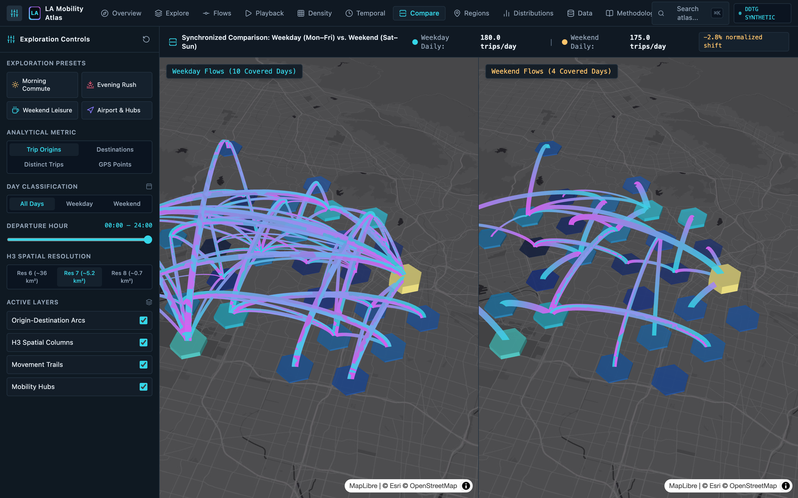
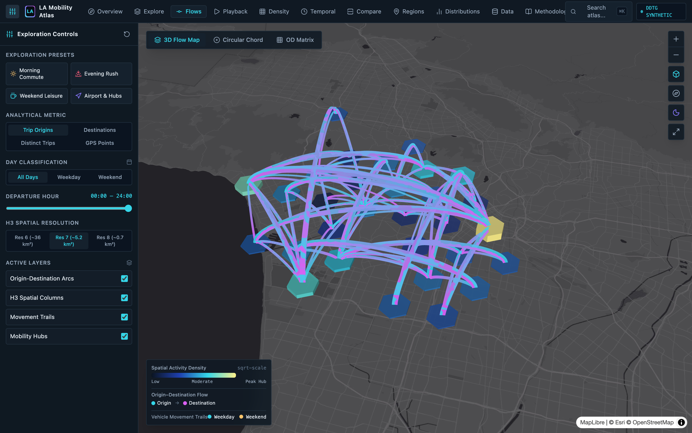
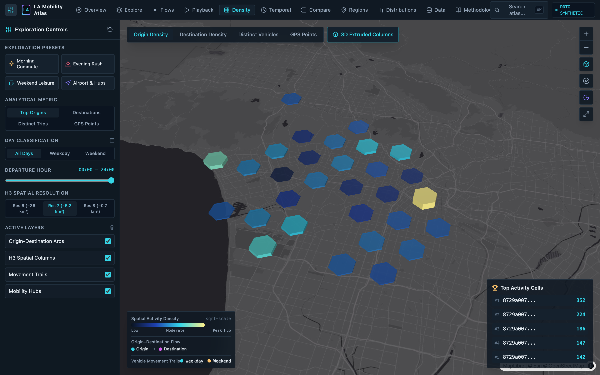
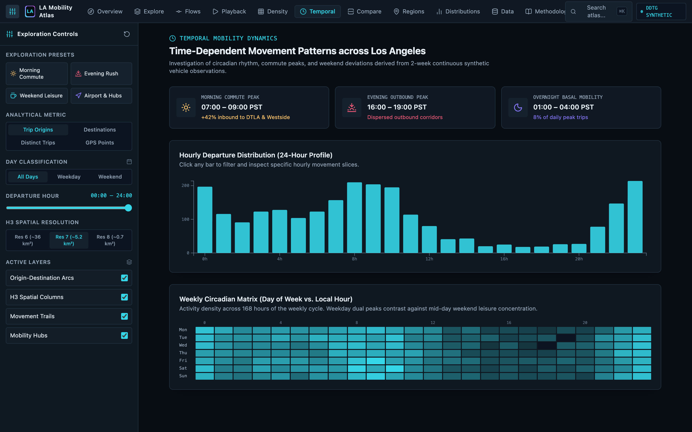
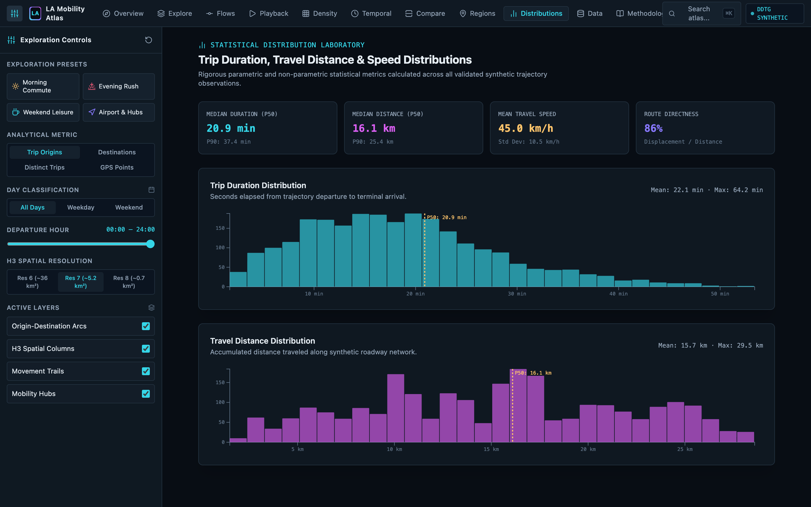
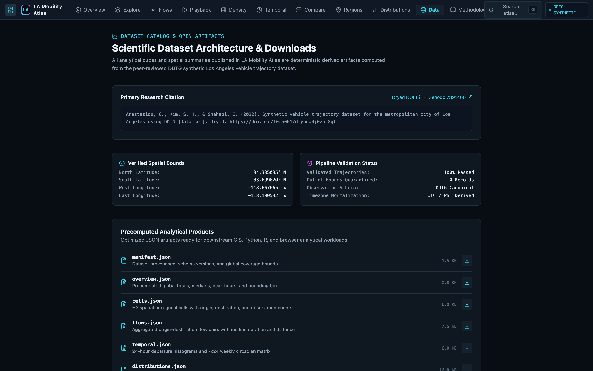

# LA Mobility Atlas

> **An interactive scientific exploration platform for investigating synthetic vehicle mobility patterns across metropolitan Los Angeles.**

[](https://la-mobility-atlas.r4na.workers.dev)

[](https://github.com/ranajahanzaib/la-mobility-atlas/actions/workflows/ci.yml)
[](LICENSE)
[](https://doi.org/10.5061/dryad.4j0zpc8gf)
[](services/api/)
[](apps/web/)
[](apps/web/)
[](pipelines/mobility/)

---

<p align="center">
  <a href="https://la-mobility-atlas.r4na.workers.dev">
    <strong>Explore the Live Platform &rarr; https://la-mobility-atlas.r4na.workers.dev</strong>
  </a>
</p>

---



---

## 1. Overview

**LA Mobility Atlas** is an open-source geospatial intelligence platform engineered to explore, analyze, and visualize high-resolution synthetic vehicle trajectories across the Los Angeles metropolitan basin.

The platform provides a map-first research environment combining GPU-accelerated 4D trajectory playback, multi-resolution hexagonal spatial indexing (Uber H3), origin–destination flow analytics, and circadian diurnal profiles.

```
+---------------------------------------------------------------------------------------+
|                                    LA Mobility Atlas                                  |
|                                                                                       |
|  [Global Overview]   [Spatial Density]   [Flow Dynamics]   [4D Trajectories]          |
|  [Circadian Matrix]  [Region Explorer]   [Distributions]   [Data & Provenance]        |
|                                                                                       |
|  +--------------------------------------------------+  +---------------------------+  |
|  |                                                  |  | Analytical Inspector      |  |
|  |             MapLibre GL + deck.gl                |  | - Total Volume: 2,500     |  |
|  |                                                  |  | - H3 Res 7 Cells: 58      |  |
|  |   - Hexagonal Density Columns (Res 6 / 7 / 8)    |  | - OD Corridors: 120       |  |
|  |   - 3D Great-Circle Flow Arcs                    |  | - Median Duration: 20.9 m |  |
|  |   - GPU TripsLayer 4D Animated Vehicles          |  | - Median Distance: 16.1 km|  |
|  |                                                  |  +---------------------------+  |
|  +--------------------------------------------------+  +---------------------------+  |
|  |  Temporal Timeline Scrubbing (00:00 - 23:59 PST) |  | Diurnal Commute Histograms|  |
|  +--------------------------------------------------+  +---------------------------+  |
+---------------------------------------------------------------------------------------+
```

---

## 2. Interactive Feature Showcase

|                                      Synchronized Comparative View (Weekday vs. Weekend)                                       |                             Origin-Destination Flow Arcs                             |
| :----------------------------------------------------------------------------------------------------------------------------: | :----------------------------------------------------------------------------------: |
|                                                                  |                                              |
| _Dual synchronized viewports contrasting 180.0 weekday trips/day against 175.0 weekend trips/day across 3D hexagonal pillars._ | _Great-circle 3D parabolic arcs connecting origin and destination activity centers._ |

|                               3D H3 Spatial Density Binning                               |                                Circadian Diurnal Profiles & Heatmap                                |
| :---------------------------------------------------------------------------------------: | :------------------------------------------------------------------------------------------------: |
|                                           |                                                 |
| _Discrete H3 hexagonal columns with net flow imbalance and ranking of top mobility hubs._ | _24-hour departure distribution capturing bimodal commute peaks and 7x24 weekly circadian matrix._ |

|                                         Statistical Distributions Laboratory                                         |                               Open Data Artifacts & Validation                               |
| :------------------------------------------------------------------------------------------------------------------: | :------------------------------------------------------------------------------------------: |
|                                                                   |                                                    |
| _Parametric and percentile metrics: P50 travel duration (20.9 min), distance (16.1 km), and route directness (86%)._ | _Deterministic JSON artifacts, SHA-256 checksums, and verified spatial bounding box status._ |

---

## 3. Scientific Dataset & Provenance

The platform visualizes the canonical research dataset:

- **Title**: _Synthetic vehicle trajectory dataset for the metropolitan city of Los Angeles using DDTG_
- **Authors**: Chrysovalantis Anastasiou, Seon Ho Kim, Cyrus Shahabi (USC InfoLab)
- **DOI**: [10.5061/dryad.4j0zpc8gf](https://doi.org/10.5061/dryad.4j0zpc8gf) | **Zenodo Record**: [7391400](https://zenodo.org/records/7391400)
- **Temporal Coverage**: December 1–14, 2019 (14 consecutive 24-hour cycles)
- **Spatial Bounding Box**:
  - **North**: $34.335035^\circ\text{ N}$
  - **South**: $33.699820^\circ\text{ N}$
  - **West**: $-118.667665^\circ\text{ W}$
  - **East**: $-118.180532^\circ\text{ W}$

> [!IMPORTANT]
> **Scientific Limitations Notice**: All trajectories are synthetically generated via the Data-Driven Trajectory Generator (DDTG) framework. They are mathematically synthesized, privacy-preserving research models calibrated against road networks and loop-detector volume counts. They are **not** real-time GPS feeds, actual personal travel logs, or official live traffic reports.

---

## 4. Platform Architecture

The platform operates on an offline-first, edge-native architecture designed for sub-second query latency and zero-egress data delivery:

```
    Dryad / Zenodo Source Trajectories
                  │
                  ▼
    Python Ingestion & Validation (pipelines/mobility/)
      - Bounding box enforcement & UTC -> PST normalization
      - H3 discrete hexagonal spatial indexing (Res 6, 7, 8)
      - Ramer-Douglas-Peucker trajectory simplification
                  │
                  ▼
    Analytical Aggregation & GeoParquet Artifacts
      - Precomputed cell activity & OD flow matrices
      - 24-hour diurnal playback chunking
                  │
                  ▼
          Cloudflare R2 Storage (data.atlas.la)
                  │
         ┌────────┴───────────────────────────┐
         ▼                                    ▼
Cloudflare Rust API Worker (WASM)    Cloudflare Workers Static Assets
   - Services /api/v1/* routes          - Next.js 16 App Router UI
   - In-memory artifact caching         - MapLibre GL + deck.gl WebGL
   - Zero-copy Serde deserialization    - D3.js Analytical Visualizations
```

---

## 5. Exploration Routes and Analytical Views

The web application exposes 12 specialized research views:

| Route           | View Name                  | Description                                           | Key Layers & Visualizations                           |
| --------------- | -------------------------- | ----------------------------------------------------- | ----------------------------------------------------- |
| `/`             | **Overview**               | Platform landing with dataset metrics and quick start | Summary cards, coverage map preview                   |
| `/explore`      | **Spatial Explorer**       | Unified multi-layer geospatial research canvas        | MapLibre base, deck.gl columns, flow arcs, inspector  |
| `/flows`        | **OD Flow Dynamics**       | Origin-destination directional exchange               | 3D geodesic ArcLayer, flow threshold filters          |
| `/trajectories` | **4D Trajectory Playback** | Continuous temporal vehicle playback                  | GPU deck.gl `TripsLayer`, 24h timeline scrubbing      |
| `/density`      | **Hexagonal Density**      | Spatial density and net flow imbalance                | H3 PolygonLayer, Diverging & Heatmap color ramps      |
| `/temporal`     | **Circadian Analysis**     | Hourly diurnal patterns and 24x7 heatmap              | D3 hourly histograms, day-hour matrix cross-filtering |
| `/compare`      | **Comparative Analysis**   | Weekday vs. weekend commute contrast                  | Dual synchronized 3D viewports, spatial shifts        |
| `/regions`      | **Regional Aggregates**    | Analysis across 9 core LA submarkets                  | Regional filters, OD transition corridor highlights   |
| `/distribution` | **Statistical Metrics**    | Parametric distributions & percentiles                | Distance/duration curves, P10..P99 percentile markers |
| `/data`         | **Data Catalog**           | Downloadable release artifacts & GeoParquet           | Schema viewer, SHA-256 integrity checksums            |
| `/methodology`  | **Scientific Methods**     | Full mathematical derivations & pipeline spec         | Formal definitions, H3 indexing theory                |
| `/about`        | **Provenance & Credits**   | Institutional attribution and citations               | BibTeX records, license terms                         |

---

## 6. Backend API (Rust / Axum)

The backend service is written in Rust using Axum and Tower HTTP. It compiles natively for local development and to `wasm32-unknown-unknown` for edge deployment via Cloudflare Workers.

### Health Check

```bash
curl -s http://127.0.0.1:8787/api/v1/health | jq .
```

```json
{
  "status": "healthy",
  "service": "la-mobility-atlas-api",
  "version": "1.0.0",
  "runtime": "native-tokio"
}
```

### Dataset Overview

```bash
curl -s http://127.0.0.1:8787/api/v1/overview | jq .
```

```json
{
  "active_destination_cells": 30,
  "active_origin_cells": 30,
  "bounding_box": {
    "east": -118.180532,
    "north": 34.335035,
    "south": 33.69982,
    "west": -118.667665
  },
  "coverage_end": "2019-12-14T23:59:59Z",
  "coverage_start": "2019-12-01T00:00:00Z",
  "median_duration_seconds": 1254.0,
  "total_observations": 76144,
  "total_trajectories": 2500
}
```

### Geographic & Regional Search

```bash
curl -s "http://127.0.0.1:8787/api/v1/search?q=Downtown" | jq .
```

```json
[
  {
    "id": "downtown-la",
    "title": "Downtown Los Angeles",
    "subtitle": "LA Region · Central business, cultural, and historic commercial core of metropolitan Los Angeles.",
    "category": "region",
    "action_type": "zoom",
    "coordinates": [-118.2518, 34.0488],
    "zoom": 13.0
  }
]
```

---

## 7. Repository Structure

```
la-mobility-atlas/
├── apps/
│   └── web/                   # Next.js 16 App Router frontend (React 19, deck.gl, MapLibre)
├── services/
│   └── api/                   # Rust Axum backend (native binary & wasm32 Worker target)
├── pipelines/
│   └── mobility/              # Python data engineering pipeline
│       ├── src/mobility/      # Ingestion, H3 aggregation, normalization, validation
│       └── tests/             # Python unittest suite (15 test suites)
├── packages/
│   ├── contracts/             # Shared TypeScript schemas & API types
│   ├── design-tokens/         # Colors, typography, spacing, and theme definitions
│   └── visualization/         # D3 color scales, deck.gl layer builders
├── data/
│   ├── processed/releases/    # Published canonical analytical JSON artifacts
│   └── fixtures/              # Deterministic test dataset fixtures
├── docs/
│   ├── screenshots/           # High-resolution application showcases
│   └── *.md                   # In-depth architectural & scientific specifications
├── scripts/
│   ├── build.sh               # Monorepo build and verification script
│   └── deploy.sh              # Edge release deployment script
└── wrangler.toml              # Cloudflare Workers & R2 edge configuration
```

---

## 8. Quick Start & Local Development

### Prerequisites

- **Node.js**: v20 or higher
- **pnpm**: v9 or higher
- **Rust**: 1.75+ (with `wasm32-unknown-unknown` target)
- **Python**: 3.11+

### 1. Clone & Install Dependencies

```bash
git clone https://github.com/ranajahanzaib/la-mobility-atlas.git
cd la-mobility-atlas
pnpm install
```

### 2. Run Data Pipeline & Unit Tests

```bash
# Execute Python data validation and unit tests
PYTHONPATH=pipelines/mobility/src python3 -m unittest discover -s pipelines/mobility/tests -p "test_*.py"

# Generate or update release artifacts
python3 pipelines/mobility/src/mobility/publishing/publisher.py
```

### 3. Start Backend API Server

```bash
# Run Rust integration tests
cargo test --tests --manifest-path services/api/Cargo.toml

# Start native development server on port 8787
cargo run --manifest-path services/api/Cargo.toml --bin la_mobility_server
```

The API is served at `http://127.0.0.1:8787/api/v1`.

### 4. Start Next.js Frontend

```bash
pnpm dev
```

Open [http://localhost:3030](http://localhost:3030) in your browser to interact with the atlas.

---

## 9. Production Build & Full Verification

To execute a complete end-to-end build across all monorepo components:

```bash
./scripts/build.sh
```

This automated verification:

1. Validates the Python data pipeline and passes all 15 unit tests.
2. Compiles and executes 6 Rust integration tests (`tests/api_tests.rs`).
3. Compiles the Rust backend for both native binary and `wasm32-unknown-unknown`.
4. Executes TypeScript strict typechecking and prerenders all 14 static Next.js routes into `apps/web/out/`.
5. Verifies all release artifacts, checksums, and output files.

---

## 10. Citation

If you use this platform or its derived data products in academic research, please cite:

```bibtex
@software{la_mobility_atlas_2026,
  author    = {Rana Jahanzaib and Contributors},
  title     = {LA Mobility Atlas: Scientific Geospatial Exploration Platform for Synthetic Urban Mobility},
  year      = {2026},
  url       = {https://github.com/ranajahanzaib/la-mobility-atlas}
}

@dataset{anastasiou_2022_ddtg_la,
  author    = {Anastasiou, Chrysovalantis and Kim, Seon Ho and Shahabi, Cyrus},
  title     = {Synthetic vehicle trajectory dataset for the metropolitan city of Los Angeles using DDTG},
  year      = {2022},
  publisher = {Dryad},
  doi       = {10.5061/dryad.4j0zpc8gf}
}
```

---

## 11. License & Custom Work

[](mailto:work@withrana.com) [](https://www.linkedin.com/in/workwithrana)
[](https://www.upwork.com/freelancers/~01bbcf6edb91a8df5f)
[](https://contra.com/ranajahanzaib/)

**License:** MIT, see [LICENSE](LICENSE). Free for personal, academic, and commercial use.

**Author:** Rana Jahanzaib

**Need this built for your stack?** Email me what you're working on: work@withrana.com
